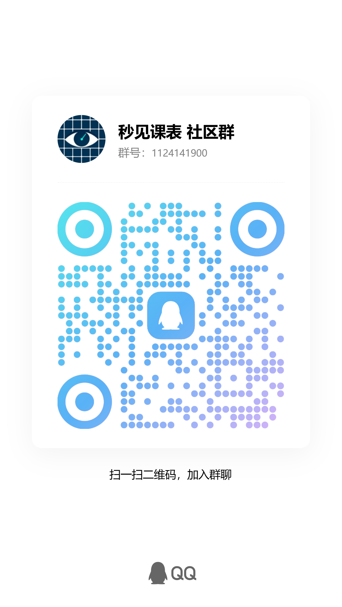

# 秒见课表（微信小程序）

一个开源的微信小程序课程表：周视图、单双周、课程冲突并排、今日/下一节课、手动增删改、新版正方教务系统导入、课表文件导入导出。

[](https://github.com/zhangyu10086/miaojian-course-table/actions/workflows/test.yml)
[](LICENSE)

> 本项目与任何学校官方无关，仅用于个人课表管理。请只登录本人的教务账号。
> 提审备注、隐私指引和上架清单见 `docs/`，版本流程见 `docs/release.md`，手机端密码加密见 `docs/client-encryption.md`。

## 截图

> 建议放 3–5 张：周课表、今日页、课程编辑、教务导入、我的页。
> 图片放 `docs/screenshots/`，例如：
>
> ```markdown
> | 周课表 | 今日 | 教务导入 |
> |---|---|---|
> |  |  |  |
> ```

## 功能

- 周视图：左侧节次时间轴，彩色课程块，左右滑动切周，周次选择器。
- 单双周：导入时展开周次，也可手动选择单周/双周。
- 冲突课程：同一天同一节次的多门课自动分列并排。
- 今日页：下一节课、倒计时、今日课程状态。
- 手动管理：添加、编辑、删除课程；编辑过的教务课程会转为手动课程，重新同步不会覆盖。
- 教务导入：新版正方 `jwglxt`，云函数登录并拉取 `kbList`；密码在手机上用学校公钥加密，云函数只转发密文。学校公钥按会话生成，取公钥和登录由云函数在同一个会话里完成（见 `docs/client-encryption.md`）。
- 学校选择：内置学校索引，支持按校名/拼音/域名搜索，最近使用的学校置顶；支持安全导入的学校标注「安全导入」，其他学校标注「仅手动」，避免用户白填账号密码。
- 公告：首页铃铛入口，有未读时显示红点；支持置顶一条、去重浏览量、未读蓝点/已读灰点、详情页，以及管理端发布/编辑/删除。发布方式见 `docs/notices.md`。
- 学校管理：管理员在小程序内新增/编辑/删除学校、开关自动导入，只写云数据库，不需要发版。入口和操作见 `docs/school-admin.md`。
- 启动偏好：可以设置打开小程序默认显示「课表」或「今日」，通过中转页在冷启动时跳转。
- 数据导入导出：支持 JSON / CSV / ICS 文件，以及剪贴板 JSON。
- 数据本地保存：课程、设置、登录信息都存在手机本地。

## 目录结构

```
course-table/
├─ miniprogram/                 # 小程序源码
│  ├─ app.js / app.json / app.wxss
│  ├─ pages/
│  │  ├─ entry/                 # 启动中转页（按偏好跳转）
│  │  ├─ schedule/              # 周课表
│  │  ├─ today/                 # 今日 / 下一节
│  │  ├─ mine/                  # 我的
│  │  ├─ course-edit/           # 添加/编辑课程
│  │  ├─ sync/                  # 教务导入
│  │  ├─ school-picker/         # 学校搜索与选择
│  │  ├─ settings/              # 学期与节次设置
│  │  ├─ privacy/               # 隐私说明与开源声明（长按进入管理员页）
│  │  ├─ admin/                 # 管理员入口：公告管理 / 学校管理
│  │  ├─ school-admin/          # 管理员新增/编辑/删除学校
│  │  ├─ notice-admin/          # 管理员发布 / 管理公告
│  │  ├─ notice-edit/           # 编辑公告
│  │  └─ notice-detail/         # 公告详情
│  └─ utils/
│     ├─ store.js               # 本地存储
│     ├─ date.js                # 周次/日期计算
│     ├─ parser.js              # 正方 kbList 解析
│     ├─ layout.js              # 课程块冲突布局
│     ├─ schools.js             # 内置学校索引与搜索
│     ├─ school-access.js       # 学校是否开放自动导入
│     ├─ transfer.js            # JSON / CSV / ICS 编解码
│     ├─ transfer-file.js       # 文件选择、读取、分享
│     ├─ rsa.js                 # 手机端 RSA 加密
│     └─ cloud.js               # 云函数调用
├─ cloudfunctions/
│  ├─ syncSchedule/             # 正方登录 + 课表抓取
│  ├─ listSchools/              # 读取学校注册表
│  ├─ manageSchool/             # 管理员新增 / 编辑 / 删除学校
│  ├─ listNotices/              # 读取公告
│  ├─ viewNotice/               # 公告详情 + 去重浏览量
│  ├─ publishNotice/            # 管理员发布公告
│  └─ manageNotice/             # 管理员编辑 / 删除 / 置顶
├─ tests/                       # Node 单元测试
├─ licenses/                    # 参考项目的许可证副本
└─ project.config.json
```

## 快速开始（本地模式）

1. 打开微信开发者工具，导入本项目根目录。
2. 复制配置模板：
   ```bash
   cp miniprogram/config.example.js miniprogram/config.js
   ```
   `config.js` 已被 `.gitignore` 忽略，用来放你本地的云开发环境 ID。
3. 用自己的 AppID 打开项目。仓库里的 `project.config.json` 使用 `touristappid` 占位，你本地改的 AppID 会写进 `project.private.config.json`，不会被提交。
4. 编译运行。首次打开进入「我的 → 学期与节次设置」，填写**第 1 周开始日期**、总周数和节次时间。
5. 回到「课表」页，点击空白格子手动添加课程，或去「从教务系统导入」。

本地模式不需要云开发，课表、手动增删改、今日课程、导入导出都能用。

## 配置教务同步

1. 在开发者工具顶部点「云开发」，开通并创建一个环境（个人主体也可以）。
2. 创建后复制环境 ID，填到 `miniprogram/config.js`：
   ```js
   module.exports = {
     cloudEnvId: '你的环境ID'
   }
   ```
   **不要提交这个文件**；仓库里只保留 `config.example.js`。
3. 右键 `cloudfunctions/syncSchedule` → **上传并部署：云端安装依赖**。云函数运行时建议选 **Node.js 18 及以上**。
4. 建议在云开发控制台给 `syncSchedule` 配置环境变量：
   ```
   ALLOWED_HOSTS=jw.your-school.edu.cn
   ```
   多个域名用逗号分隔，支持 `*.edu.cn` 这样的通配。不配置则允许任意域名，安全性较低。
5. 打开小程序「我的 → 从教务系统导入」，先选择学校（也可手动输入地址），再填写：
   - 教务地址：如 `https://jw.example.edu.cn`
   - 学号、密码
   - 学年：起始年，如 2026
   - 学期：第一学期 / 第二学期 / 短学期

> 账号密码只在手机上输入，云函数只在本次调用中使用，不保存、不打印。不要把自己的账号密码发给任何人。

## 学校列表与新增学校

学校注册表放在云数据库的 `schools` 集合，小程序端和云函数共用这一份数据：

- 小程序通过 `listSchools` 云函数拉取，本地缓存 24 小时；拉取失败时回退到 `miniprogram/utils/schools.js` 的内置列表
- `syncSchedule` 用 `schools` 集合里的 `host` 做域名白名单（云函数内缓存 60 秒）
- `autoImport` 决定是否开放自动导入：`true` 显示「安全导入」，`false` 显示「仅手动」，缺省时回退到本地白名单
- 云函数环境变量 `ALLOWED_HOSTS` 保留为兜底，两者取并集

### 初始化（只需一次）

1. 云开发控制台 → 数据库 → 新建集合 `schools`
2. 导入 `docs/schools-seed.json`（每行一个 JSON 对象，文件后缀必须是 `.json`）
3. 可选：再导入 `docs/schools-batch.json`，包含从 `shiguang_warehouse` 整理的 25 所新版正方学校，以及新增的新疆农业大学，共 26 所
4. 部署 `listSchools`、`syncSchedule`、`manageSchool` 三个云函数
5. 给 `manageSchool` 配置环境变量 `ADMIN_OPENIDS`，值和管理公告用的 `publishNotice` 一致
   - 微信云开发的环境变量是**按云函数单独配置**的，不会互通

> 已经导入过旧数据需要更新时，重新导入选「覆盖」；如果控制台没有覆盖选项，先清空集合再导入。

### 新增学校（日常，不需要发版）

1. 打开小程序 →「我的」→ **长按「隐私说明与开源声明」**
2. 进入管理员页 →「学校管理」
3. 点「新增学校」，填学校名称、教务地址（如 `https://jwglxt.example.edu.cn`）、搜索别名
4. 打开「开放自动导入」，保存
5. 约 1 分钟生效。用户重新打开学校选择页，或下拉刷新，就能看到

整个过程只写云数据库，不需要改代码、上传小程序或等审核。`manageSchool` 会校验 `ADMIN_OPENIDS`，只有管理员能操作。

> 如果新学校还没实测，可以先打开自动导入并保持「待验证」；有同学导入成功后，`syncSchedule` 会自动把 `verified` 改成 `true`。

### 字段说明

| 字段 | 说明 |
|---|---|
| `_id` | 唯一标识，新学校由域名自动生成 |
| `name` | 学校全称 |
| `aliases` | 拼音/缩写数组，用于搜索 |
| `baseUrl` | 教务系统地址 |
| `host` | 教务域名，必须与地址完全一致 |
| `system` | 目前只支持 `zfn_v2`（新版正方） |
| `autoImport` | 是否开放自动导入 |
| `verified` | 是否实测跑通过 |

### 批量导入与拼音别名（初始化时用）

第一次建库可以批量导入，并用脚本生成全拼别名：

```bash
npm install
npm run schools:aliases
node scripts/build-school-aliases.js 某某大学
# ["wuchanggongxueyuan","wcgxy"]
```

脚本读取 `docs/schools-seed.json` 和 `docs/schools-batch.json`，为每所学校生成全拼和首字母，去重后合并进 `aliases`。只改文件不导入数据库不会生效。

日常新增学校不再需要跑脚本，直接在学校管理页的「搜索别名」里填 `wuit, wcgxy` 即可。

注意：

- 云函数缓存 60 秒，新增学校后最多 1 分钟生效
- 小程序内的学校选择只负责填地址，登录和解析仍由云函数完成
- 云函数支持 HTTP、非 443 端口，不受小程序域名白名单限制
- 各校正方版本可能不同，未跑通的学校建议先保持「待验证」
- 不要清空所有白名单——那等于允许访问任意地址，有 SSRF 风险

## 正方接口说明

云函数按新版正方（jwglxt）流程实现，分为两步调用：

**第一步 `{ action: 'prepare' }`**

1. `GET {base}/xtgl/login_slogin.html`：建立会话，取 `csrftoken` 和 Cookie。
2. `GET {base}/xtgl/login_getPublicKey.html`：在**同一个会话**里取 RSA `modulus/exponent`。
3. 把公钥返回给手机，同时把这条会话（Cookie + `csrftoken`）打包成 5 分钟有效的 token。

**第二步（手机完成本地加密后）**

4. `POST {base}/xtgl/login_slogin.html`：用 token 恢复会话，提交 `csrftoken + yhm + RSA 加密后的 mm`。
5. `POST {base}/kbcx/xskbcx_cxXsgrkb.html?gnmkdm=N2151`：
   - `xnm` 学年起始年
   - `xqm`：`3` 第一学期 / `12` 第二学期 / `16` 短学期
   - `kzlx=ck`、`xsdm=`
6. 从返回 JSON 的 `kbList` 中取 `kcmc/xm/cdmc/xqj/jcs/zcd`。

> 为什么不能由手机自己取公钥：正方公钥按会话生成，每次请求都会轮换，私钥只存在于学校当前的 `JSESSIONID` 里。手机另开会话取到的公钥，云函数登录时用不上。实测示例学校就是这样。

如果学校做了定制，常见调整点：

- 登录页不是 `/xtgl/login_slogin.html`：改 `normalizeBaseUrl` 和 `login` 里的路径。
- 课表接口不是 `xskbcx_cxXsgrkb`：改 `fetchKbList` 的 URL。
- 字段名不同：改 `miniprogram/utils/parser.js` 的 `parseKbList`。
- 有验证码/滑块：自动导入会返回 `CAPTCHA_REQUIRED`，目前只能手动添加。
- 教务系统只允许校园网/VPN：云函数访问不到，需换网络环境或自建代理。

## 真机前的隐私配置

小程序里用到了剪贴板接口，真机/体验版前需要在微信公众平台配置「用户隐私保护指引」：

- **剪贴板**：用于导出/导入课表文件，以及复制公告中的交流群号。

路径：公众平台 → 设置 → 服务内容声明 → 用户隐私保护指引。未配置时，真机上相关接口可能直接失败。

## 体验版发布

1. 开发者工具点「上传」，填版本号和备注。
2. 公众平台 → 管理 → 版本管理 → 把开发版设为「体验版」。
3. 在「成员管理」里把自己加为体验成员，扫码使用。
4. 体验版不需要提交审核，适合自用。

## 测试

```bash
npm test
```

> `tests/cloud-flow.test.js` 需要云函数依赖。首次运行前在 `cloudfunctions/syncSchedule` 执行 `npm install`。

覆盖：

- 周次解析：普通周、单双周、多段周次、中文括号。
- 节次解析：单节、连续、多段、相邻合并。
- `kbList` 归一化：合并重复课程、拆分不连续节次、过滤超范围周次。
- 周次计算：学期前、学期中、学期后、周日作为每周起始日。
- 冲突布局：无冲突、两课冲突、三课冲突、非当前周过滤。

## 合规与风险

- 个人主体 + 代登录学校教务系统，公开上架存在审核不通过、被投诉下架的风险。首发版保留该功能时，务必使用页面上的「本人账号」确认和隐私说明。
- 上架前必须完成小程序 ICP 备案；类目建议「工具 > 效率」，不要选教育类。具体步骤见 `docs/launch-checklist.md`。
- 提审备注参考 `docs/review-notes.md`，后台隐私指引参考 `docs/privacy-declaration.md`，页面文案要与后台声明保持一致。
- 如果审核要求，隐藏「从教务系统导入」入口，只保留手动录入和 JSON / CSV / ICS 导入导出，可以显著降低风险。
- 请只使用自己的教务账号，不要代登录他人账号，不要批量抓取。
- 教务系统可能随时改版，适配代码需要自己维护。
- 保留 `THIRD_PARTY_NOTICES.md` 与 `licenses/` 中的署名和许可证。

## 参考项目与致谢

本项目为独立实现，但以下项目的思路给了很大帮助：

- [拾光课程表 shiguangschedule](https://github.com/XingHeYuZhuan/shiguangschedule)（Apache-2.0）：数据模型、周视图交互、冲突布局思路。
- [shiguang_warehouse](https://github.com/XingHeYuZhuan/shiguang_warehouse)（MIT）：正方 HTML 课表解析思路，周次（`zcd`）与节次（`jcs`）解析。
- [正方教务接口说明（新版）](https://github.com/openschoolcn/zfn_api)：登录与课表接口参考。

第三方许可证副本见 `licenses/`，完整声明见 [THIRD_PARTY_NOTICES.md](THIRD_PARTY_NOTICES.md)。

## 参与贡献

欢迎提交 Issue 和 PR：

- 使用问题、功能建议：到 Discussions
- Bug：用「Bug 反馈」Issue 模板
- 学校适配：用「学校适配申请」模板，只填学校名和教务地址，**不要填账号密码**
- 代码贡献请先读 [CONTRIBUTING.md](CONTRIBUTING.md)
- 安全问题请按 [SECURITY.md](SECURITY.md) 私下报告

## 交流群

扫码加入 QQ 群，群号 **1124141900**：



进群请说明来意（使用反馈 / 学校适配 / 开发）。群内不代登录、不收集账号密码。

## 许可证

[MIT](LICENSE)

## 免责声明

- 本项目与任何学校、教务系统厂商均无隶属关系。
- 教务导入仅供用户登录**本人**账号使用，请勿代登录他人账号或批量抓取。
- 学校教务系统可能随时改版，导入功能可能失效，请以手动录入作为保底。
- 使用本项目产生的任何后果由使用者自行承担。

## 常见问题

**导入提示「云开发还没有配置」**
：`miniprogram/config.js` 里的 `cloudEnvId` 没填，或云函数没部署。按「配置教务同步」操作。

**导入提示「账号或密码错误」**
：先确认能在浏览器登录教务系统；如果浏览器登录需要验证码/滑块，自动导入不可用。如果浏览器能登录、小程序一直失败，确认已升级到 1.2.1 及以上：1.2.0 及更早版本有两处问题——手机端单独取公钥，遇到按会话轮换公钥的学校会失败；1024 位公钥带 Java 前导零时，填充长度算错一字节，学校解出的密码不正确。

**导入提示「返回的不是预期课表数据」**
：多半是学年/学期选错，或学校改了接口路径。先用浏览器登录，打开课表查询页确认参数。

**课表显示空白**
：检查「学期与节次设置」里的第 1 周开始日期、总周数，以及课程周次是否包含当前周。

